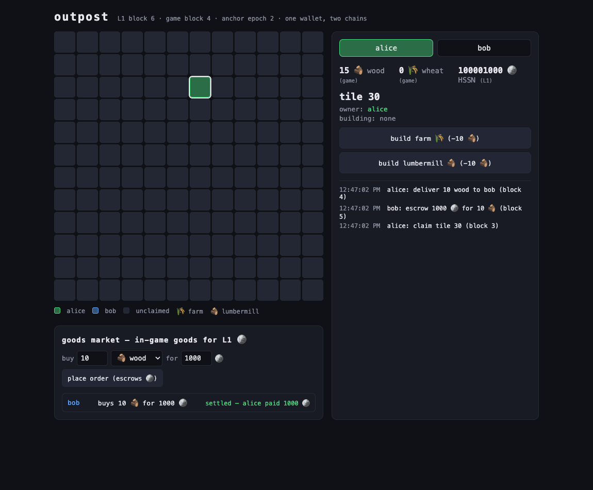
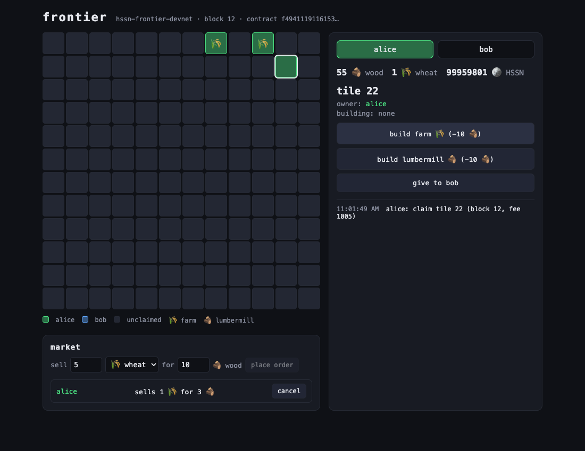

# Mordecai


**A decentralized operating system for peer-to-peer software.** Apps get
identity, payments, contracts, and distribution the way they get a
filesystem — by asking the runtime. Holepunch/Pear provides networking,
storage, and app delivery; a small deterministic settlement chain provides
the money; and every app can spin up **its own chain** among its own
players, anchored back to settlement with ~100 bytes.

No hosting. No bridges. No wallet extensions. One Ed25519 identity,
everywhere.

```
who has to agree?          lane            primitive
─────────────────────      ─────────       ─────────────────────────────
nobody (one author)        content         Hypercore feeds
the app's peers            app chain       same chain stack, per-app
everyone (money)           L1              the settlement chain
```

## Try the node website

```sh
pnpm install && pnpm build
node scripts/node-demo.mjs           # → http://127.0.0.1:8790
```

Create an **Account** to receive 1,000,000 test CAI automatically, or load an existing
account. Save its private-key backup and open
**Demos**. Hex and Chess offer game rooms; Frontier is a shared land-and-trading
world; Outpost focuses on goods orders and settlement. The
[Microblog](docs/src/examples/microblog.md) lets readers tip authors, and
[Bounties](docs/src/examples/bounties.md) lets people fund questions and award a
response. The launcher keeps its data across restarts in `.mordecai-demo/`.

To host the whole demo on Render, use the root `render.yaml` Blueprint, which
configures one Docker service and a persistent disk at `/data`.
[Deploy to Render](https://render.com/deploy?repo=https%3A%2F%2Fgithub.com%2FStuartFarmer%2Fmordecai%2Ftree%2Fmain)
or follow the [Render deployment guide](docs/src/render.md). This requires a paid
service and disk. The [Railway deployment guide](docs/src/railway.md) is also available.

## Outpost: goods, orders and settlement across two chains



**Outpost** is a goods exchange where production runs on a **player-run app
chain** (claim land, build, harvest) and the
**goods market runs on L1** (test CAI, escrowed). One wallet identity
acts on both. The trade in that screenshot:

1. **bob (L1)** escrows 1000 CAI for 10 wood — a good that _only exists
   inside the game_.
2. **alice (app chain)** delivers the wood in-game, to the same address
   bob uses on L1.
3. The app chain's quorum **anchors** its state root plus one outcome
   call — `settle(order_id, alice)` — and the L1 market releases the
   escrow.

CAI never left L1. Wood never left the game. The anchor carried
_judgment_, not value — there is no bridge to hack, and a corrupt game
can only ever touch what was voluntarily staked against it. Alice's L1
balance ends at exactly +1000: her only L1 transaction was getting paid.

```sh
pnpm install && pnpm build
pnpm --filter @mordecai/example-outpost-web build
node scripts/outpost-demo.mjs        # → http://127.0.0.1:8787
```

## What's groundbreaking here

**⛓️ App chains: consensus as a library.** The node — chain, BFT, VM — is
just packages. An app instantiates a blockchain the way it opens a
database: derive a genesis from the on-chain registry entry, join the
swarm, play. Seasons and matches get their own disposable chains; once
anchored, the block history can evaporate while the outcome lives forever
on L1. (`@mordecai/appchain`, [docs](docs/src/architecture/app-chains.md))

**🐍 A Pythonic contract DSL.** Game rules, escrow, markets — written like
Python, compiled to deterministic WASM (`mordecaic`: parse → typecheck → Rust
→ wasm32), running identically on L1 and every app chain. The entire L1
side of the outpost economy is this:

```python
contract GoodsMarket:
    config:
        game: address              # appAddress(appId) — no private key exists

    action place_order(good: str, amount: int):
        require(value > 0, "attach the payment as value")   # escrows attached CAI
        ...

    action settle(order_id: int, seller: address):
        require(sender == config.game, "only the game may settle deliveries")
        o = Order[order_id]
        require(o.phase == 0, "order is not open")
        o.phase = 1
        transfer(seller, o.price)
```

**⚓ Settlement ↔ app-chain communication with no bridge.** The only
cross-chain artifact is the _anchor_: >2/3 of the app's registered
validators sign `(epoch, height, stateRoot, outcome call)`, anyone relays
it in an ordinary transaction, and L1 executes the call with
`sender = appAddress(appId)` — a derived account no private key can
forge. Authorization on the contract side is one line of DSL. No wrapped
tokens, no exit games, no oracle network.

**🌐 The web tier: dapps without extensions.** Browsers can't join the
DHT, so any node operator can run a **gateway** — an untrusted HTTP edge
that relays _signed_ transactions and raw state. The frontier demo is a
full on-chain land game in a browser: keys in the page, Ed25519 via
`@noble/curves` over the same canonical bytes the wallet daemon signs,
65 KB gzipped, zero backend.



**📦 P2P everything else.** Apps ship as signed Hypercore bundles indexed
by the on-chain registry (everyone who installs, seeds — BitTorrent for
software with a chain as the tracker). Game moves, chat, and content ride
feeds; the wallet daemon holds keys behind per-app permission grants; the
chess example plays a wagered match entirely peer-to-peer with only the
escrow touching consensus.

## Install

Node ≥ 20 with corepack (pnpm is pinned via `packageManager`) and mdBook 0.5.2
for the bundled documentation. Install a prebuilt mdBook release, or run
`cargo install mdbook --version 0.5.2 --locked` with Rust installed. Rust and
Python are only needed to rebuild WASM artifacts — prebuilt contracts are
committed.

```sh
git clone https://github.com/StuartFarmer/mordecai.git && cd mordecai
pnpm install
pnpm build      # typecheck + emit packages and bundle the documentation
pnpm test       # devnets, BFT, VM, app chains, gateways, CLIs, e2e
```

## Try everything

| One command                                            | What you get                                                                                                                                                        |
| ------------------------------------------------------ | ------------------------------------------------------------------------------------------------------------------------------------------------------------------- |
| `node scripts/outpost-demo.mjs`                        | **The flagship**: MMORTS on an app chain + L1 goods market + anchored settlement, playable at `:8787`                                                               |
| `node scripts/hex-demo.mjs`                            | **Play strangers for money**: winner-takes-all Hex — rules + 3-minute forfeit clock on an app chain, escrow on L1, wallets generated in the page, join by game code |
| `node scripts/frontier-demo.mjs`                       | On-chain land game in the browser through the gateway                                                                                                               |
| `node apps/devnet/devnet.mjs 4`                        | A 4-validator BFT devnet with a funded faucet                                                                                                                       |
| `npx vitest run packages/appchain/test/market.test.ts` | The cross-chain trade proven at the protocol level, adversarial cases included                                                                                      |
| `npx vitest run packages/appchain/test/season.test.ts` | A wagered season: stake on L1, play on an app chain, anchored payout, then _delete the app chain_ — the settlement survives                                         |

## Deploy on Railway

Nothing here _needs_ hosting — that's the point. But an always-on peer is
useful: an app chain whose players come and go still wants a validator
that never sleeps, and browsers need a gateway to reach the DHT at all.

There are **two node roles**: validators and peers. Both sync and verify
state, store and serve chain history, seed app data, and provide HTTP
access. A validator additionally proposes and votes on blocks. The node
detects its role from its identity and the network's validator set.

A settlement node serves the settlement network; an app node serves one
app's network. Connecting to an app does not also download the settlement
chain: it reads the app's registration through settlement RPC.

### Build and storage

Node ≥ 20 with corepack. Install mdBook 0.5.2 in the build environment;
it is not needed at runtime. The WASM runtime and contracts are committed.

```
Build: corepack enable && pnpm install --frozen-lockfile && pnpm build
```

Mount a persistent volume at `/data`. It keeps your identity, chain history,
and downloaded feeds across restarts. Losing a validator key means losing
a member of that network's quorum.

### Connect to an app

Join a peer directly, without any settlement network:

```sh
mordecai app connect --dir /data/app --app http://192.168.1.20:8787
# IP shorthand also works: --app 192.168.1.20:8787
```

Or resolve an app ID through a settlement registry:

```sh
mordecai app connect --dir /data/app --app com.example.game \
  --settlement-node "$SETTLEMENT_RPC_KEY" --port "$PORT"
```

These are the installed CLI commands; from a checkout, substitute
`node bin/mordecai.mjs app` for `mordecai app`.

HTTP(S) URLs and IP addresses fetch `/api/connect` from the chosen peer.
Domain URLs require a scheme (`https://game.example.com`); a bare name
such as `com.example.game` is a registry lookup and requires
`--settlement-node`. The older `--l1-node` flag remains an alias.
A failed direct lookup never falls back to settlement.

Both paths create or reuse `peer.key`, derive the app's chain from its
configuration, start all services, and seed the advertised feeds. Registry
lookups automatically include the registered bundle. Startup reports the
role, RPC key and HTTP URL. Every joined peer also exposes `/api/connect`,
so it can introduce the next peer.

Direct discovery trusts the chosen peer's initial configuration; registry
lookup trusts the selected settlement network. Subsequent chain data is
verified against that configuration. Optional settlement metadata does not
make a direct join contact settlement or start spending funds.

See [standalone app networks](docs/src/apps/app-chains.md#start-without-settlement)
for starting the first peer without a registry.

Use `--feed <hex-key>` for additional app-selected data feeds (repeatable),
`--static <dir>` to serve a built browser frontend, and `--config <file.json>`
for its configuration. Downloaded bundles are seeded, not automatically
executed or unpacked; installation still verifies the registry hash.

For a new validator, generate its identity before choosing the app's validator set:

```sh
mordecai app init --dir /data/app
```

Put the printed public key in the app's local or registered validator set. The same
`connect` command then starts voting automatically. Ordinary peers need no
`init` step. `start` remains an alias for `connect`.

### Connect to settlement

```sh
node bin/mordecai.mjs l1 connect \
  --dir /data/l1 --genesis ./genesis.json --port "$PORT"
```

The first connection saves the supplied network genesis and creates an
identity. Later connections reuse that directory. Everyone joining the
same network must use the same genesis. HTTP runs automatically on both
roles, including networks with a single validator.

Without `--port`, the CLIs use `PORT` or choose an available port and print
it. For programmatic use, `Node.start({ ... })` exposes `node.gateway` and
`node.network`; `AppChain.join(...)` exposes these through `app.node`.
The gateway binds all interfaces; normal HTTP ingress configuration still
applies. A standalone gateway remains available for separate web deployments,
but connecting a node does not require one.

### Settlement outcomes

Validators automatically answer anchor co-signing requests. Relaying
anchors to L1 remains app-specific: add
`--anchor --l1-chain-id <id> --relayer <file>` for periodic state-root
anchors, paid for by the funded relayer. Outcome calls such as
`settle(order_id, winner)` use `AnchorDaemon`'s `outcome` hook. Connecting
a peer does not authorize spending settlement funds.

### The one thing to verify

The native peer mesh uses DHT discovery and UDP hole punching; it does
not need an inbound TCP listener. HTTP discovery and browser access do
require a reachable gateway port. Check outbound UDP works from Railway's NAT.
Connections are outbound-initiated, so this generally works, but it isn't
something to assume: check `waitForPeers()` resolves, or that `height` is
advancing, before trusting a deployment. Omit `bootstrap` and you get the
public DHT; pass it only for private testnets.

## Documentation

Every built node serves the [mdBook](docs/) at `/docs/`, linked from its compact
homepage. `pnpm build` bundles the book; `pnpm build:docs` refreshes it after
edits. For live-reloading author previews, use `mdbook serve docs`.

- [Field Guide](docs/src/field-guide.md): join a network, create a wallet, start or join an app, and send a payment.
- [Architecture](docs/src/architecture/overview.md) · [Three (four) kinds of state](docs/src/architecture/state.md) · [App chains](docs/src/architecture/app-chains.md) · [Consensus](docs/src/architecture/consensus.md) · [Threat model](docs/src/architecture/threat-model.md)
- [Building p2p apps](docs/src/apps/what-is-a-p2p-app.md) · [The SDK](docs/src/apps/sdk.md) · [The web gateway](docs/src/apps/gateway.md) · [**How-to: run your app on its own chain**](docs/src/apps/app-chains.md)
- [The DSL](docs/src/contracts/dsl-reference.md) · [Contract tutorial](docs/src/contracts/tutorial.md)
- Examples: [chess](docs/src/examples/chess.md) · [frontier in the browser](docs/src/examples/frontier-web.md) · [**outpost**](docs/src/examples/outpost.md)

Specs: [`SPEC_PT_01–03.md`](SPEC_PT_01.md) (platform) ·
[`SPEC_APPCHAINS.md`](SPEC_APPCHAINS.md) (app chains) ·
[`SPEC_TOKENOMICS.md`](SPEC_TOKENOMICS.md) (validator policy + CAI emission, _design draft_) ·
[`IMPLEMENTATION_PLAN.md`](IMPLEMENTATION_PLAN.md)

## Status

**v1 core complete (M0–M7) plus the app-chains tier.** The spec §28
vertical slice — registry install, wallet auth, p2p state sync, finalized
payment — passes on a multi-validator devnet, and the app-chains
acceptance (stake → play on a disposable chain → anchored settlement)
passes over a real DHT testnet. Honest limits are catalogued in the
[roadmap](docs/src/roadmap.md): permissioned validator sets, anchors
attest rather than prove (blast radius is per-app by construction), and
the Pear desktop shell itself is still product work.
