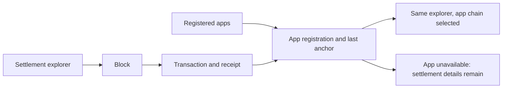

# Settlement and app-chain explorer

Status: implemented and verified on 2026-10-26 on `feature/block-explorer`,
using subagents for implementation and independent reviews.

## Intent and scope

Let visitors inspect settlement blocks and transactions, find registered apps by
name/ID, and inspect each available app chain through the same interface. Keep
registration and settlement-anchor information useful when app peers disappear.
The user explicitly accepts that historical app blocks depend on available peers.

The user calls settlement L0; existing code calls it L1. Use **Settlement (L0)**
in the explorer without renaming existing code, CLI commands or protocol fields.

Deliver the entire feature before adding its links to the main node navigation.
The implementation has two functional increments: settlement plus registry reads,
then app-chain reads. These are steps toward one release, not a decision to defer
the user's app explorer indefinitely.

## Approach

Use the existing gateway, RPC client, protocol decoder, browser address/hash
helpers, CSS and Vite bundle. AppChain already instantiates the same node stack.
The user's agreement followed this recommendation in the investigation.

Alternatives considered: a separate explorer service duplicates serving and
deployment; a persistent indexer helps address histories and aggregate searches
but is unnecessary for block-by-height, transaction-hash and registry browsing.
Neither is part of this design. No new dependencies or consensus changes.

## Pages and navigation

Add **Explorer** and **Apps** links next to the existing Account/Demos navigation.
Both work without creating or loading an account. Use two ordinary persistent
sections in the existing SPA and hash query parameters, not a new router.

| URL                                         | Screen                                         |
| ------------------------------------------- | ---------------------------------------------- |
| `#/explorer`                                | Settlement head and ten most recent blocks     |
| `#/explorer?height=42`                      | Settlement block and its transactions          |
| `#/explorer?tx=<hash>`                      | Settlement transaction and execution receipt   |
| `#/apps`                                    | Registered apps, 50 per page                   |
| `#/apps?app=<encoded-app-id>`               | Registration, latest anchor and app-chain link |
| `#/explorer?app=<encoded-app-id>`           | That app's head and recent blocks              |
| `#/explorer?app=<encoded-app-id>&height=42` | App block                                      |
| `#/explorer?app=<encoded-app-id>&tx=<hash>` | App transaction                                |

`before=<height>` selects older block pages; `after=<encoded-app-id>` selects the
next registry page. A block page contains at most ten blocks, descending and
excluding `before`. No negative heights. Reject conflicting height/tx/before
selectors with a useful message. Use URLSearchParams for every link.

Use the existing compact dark styling: a heading, network label, lookup form,
data table/list and previous/next links. No charts. Block rows show height,
timestamp, transaction count and hash. Block details add proposer, previous
hash and state/transaction roots. Transaction rows show hash, kind and sender;
fetch receipts only when opening a transaction, not for every row.

Transaction details decode the existing payload and show sender, nonce, maximum
fee, actual fee, success/failure, events and error/return bytes. Reuse existing
formatting where useful without changing wallet signing behavior. Render byte
fields safely as hex; contract arguments/events have no generic application ABI.
Amounts are integer **CAI base units** on settlement and **app-chain base units**
on an app chain. Keep bigint values exact.

The lookup form accepts a decimal block height or 64-character transaction hash,
with an explicit lookup type to avoid ambiguity. Address history, block-hash
lookup, mempool listings, analytics and contract-specific decoding are excluded.

## Apps and anchors

The directory comes from settlement registry state, not the enabled-demo menu.
Match `config.demos[name].appId` to existing `DEMOS[name].title` for a friendly
local label. Always show the registered ID; other apps use their ID as the name.
Do not invent publisher-authenticated names: the registry has no name field and
`metadataHash` is currently used by the SDK to verify a bundle.

Show owner, version and whether `chainValidators` is empty in directory rows.
Fetch the latest anchor only on the app-detail page. Show contract, bundle key,
validator keys and metadata hash in expandable details. An empty validator set
means **No app chain**, not an outage. Do not fabricate registry entries for
demos that are only settlement contracts or feeds.

App details show **Last anchored height**, epoch and state root, or **No anchor
yet**. This is separate from a live app head. Settlement anchor transaction
details also show signatures and optional outcome call, and link to the app.
An anchor payload in a failed transaction must say it was not accepted. On an
app chain, anchor results describe that chain only; nested registration IDs stay
visible as payload text and do not link to the settlement registry.

The latest-anchor record has no settlement transaction hash, so do not invent a
transaction link or scan the entire chain to find one. Older anchors remain
inspectable through settlement blocks/transactions; an app-filtered anchor
timeline is outside this version. An unavailable block does not mean the anchor
is invalid, or that the data is permanently gone.

## Read interfaces

| Interface                                                            | Contract                                                            |
| -------------------------------------------------------------------- | ------------------------------------------------------------------- |
| RPC `get_apps {after?, limit?}`                                      | `{apps: AppInfo[], nextAfter: string \| null}`; default 50, max 100 |
| HTTP `GET /api/apps?after=…&limit=…`                                 | Same registry page, in UTF-8 app-key order                          |
| HTTP `GET /api/block/<height>`                                       | Existing `BlockInfo`, or 404                                        |
| HTTP `GET /api/app/<id>`                                             | Existing registry entry plus latest anchor, unchanged shape         |
| HTTP `GET /api/app/<id>/chain/head`                                  | Existing `HeadInfo` from an app peer                                |
| HTTP `GET /api/app/<id>/chain/block/<height>`                        | Existing `BlockInfo`, or 404                                        |
| HTTP `GET /api/app/<id>/chain/tx/<hash>`                             | Existing `TxInfo`, or 404                                           |
| HTTP `GET /api/app?appId=<id>`                                       | Query alias for existing registration and anchor read               |
| HTTP `GET /api/app/chain/{head,block/<height>,tx/<hash>}?appId=<id>` | Query aliases for the corresponding app-chain reads                 |

Existing `/api/head`, `/api/tx/<hash>` and mounted demo APIs remain compatible.
Validate heights as decimal u64, hashes as exactly 32-byte hex, app IDs/cursors
as nonempty UTF-8 strings at most MAX_APP_ID_BYTES (64 bytes), and limits as
integers 1–100. Do not introduce a narrower ID character policy than the registry.
Decode path segments once and reject malformed encoding. The query aliases
require exactly one `appId` and reject unknown or malformed
parameters. The browser uses these aliases for `.` and `..`, since URL parsers
remove dot-only path segments even when percent-encoded. Other IDs retain the
existing path URLs, including the ID `chain`; query aliases also accept them.
Bad input returns 400; missing data/registration returns 404; no app chain returns 409; unreachable,
wrong-chain or busy upstream returns 503. New explorer routes return JSON errors
with a stable `code` and human-readable `error`, without changing legacy shapes.

Enumerate the existing `app:` state keys through StateStore.entries(), decode
current entries and stop after limit+1 matching rows. The cursor is exclusive.
This returns bounded pages but can scan unrelated/earlier state. Use a documented
devnet-scale shortcut; a range iterator is the later upgrade, not a new index now.
No protocol version, stored encoding or genesis changes are needed.

## App connections and lifetime

Resolve registrations through settlement for each app-read request. Reuse an
existing mounted network when `config.demos[name].appId` identifies that app;
otherwise dial its registered validator RPC keys server-side. Use the mount's
bootstrap for a configured app, or the gateway's bootstrap otherwise. This
supports the current shared devnet and public DHT; independently configured
private DHTs need an operator-provided mounted network.

Verify the peer head's chainId equals `app:${appId}` before serving data. Try
other registered keys on failure or missing requested data, within one shared
five-second deadline, with each attempt capped at one second. Report unavailable
when no peer responds; if a matching peer responds but none supplies the item,
report **Data unavailable from reachable peers** (404). A transaction 404 means
not found/unavailable, never automatically pending or failed.

Use request-scoped clients for dynamic connections and close them in finally;
borrowed mounted clients retain the gateway's existing lifetime. Limit app-read
requests to eight in flight per gateway, with no unbounded queue; excess requests
get 503. Do not accept user-supplied network URLs/keys or start app nodes. A later
connection cache is optional only if measurements justify it.

RPC results are reported by the connected node. Chain-ID checks and transaction
hash checks detect mix-ups; this is not a light client or an independent proof of
consensus. An accepted settlement anchor attests the app quorum's claim, not
independent execution validity.

## Browser behavior and release checks

Fetch at most two block bodies concurrently. Keep recent-page summaries and fetch
only new heights when the head advances; never download unchanged block pages on
every poll. Poll the visible latest-head view every five seconds. Stop/abort on
navigation or tab hiding, and refresh on return. Immutable detail pages do not
poll. Use a ten-second browser timeout and ignore stale responses after navigation.

Transaction deep links use receipt height/index to fetch and decode the containing
block; check the decoded transaction hash matches the requested hash. A receipt
can remain visible when its body is unavailable, with that limitation stated.

Preserve loaded account state, back/forward, deep links, keyboard focus, mobile
readability and custom --static frontends. All external text uses textContent.
The standalone account page must remain usable when explorer sections are absent.

Ship only after registry pagination, settlement/app isolation, unavailable peers,
failed anchors, large integer decoding and navigation cancellation are covered.
No permanent app archive is promised. Full block bodies can be large; if this
becomes material, add a summary RPC before expanding the page size.

## Implementation boundaries

Change chain registry reads; RPC messages/server/client; gateway routes and a
small app-read helper; browser explorer module; site navigation/markup/styles;
targeted tests and RPC/gateway docs. Existing barrel exports cover new public
chain methods and RPC message types. Existing Vite entry/build scripts can include
the browser module through an import. Do not add packages or change demo launchers.

The working tree already has ongoing account/demo edits. Re-read those files at
implementation time, preserve the edits and stage only the explorer's changes.
Design defaults such as page sizes and deadlines are recommendations made here,
not previously stated user requirements.
